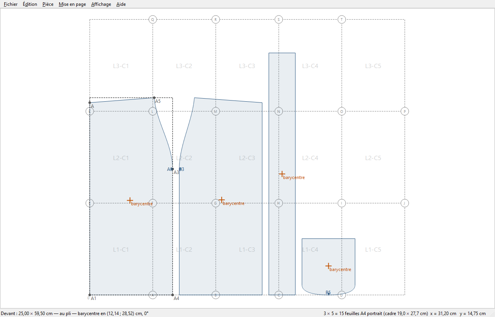

# CutLayout

Petite application pour imprimer **à l'échelle 1:1** les pièces d'un patron [Seamly2D](https://seamly.io), en mosaïque de feuilles A4 ou A3 à découper et à assembler.



## Pourquoi cette application

J'ai commencé la couture récemment et dessiné mon premier patron, un buste homme, avec **Seamly2D** : un logiciel de patronnage gratuit, porté par une grande communauté. Ses modes « croquis » et « pièce » sont très réussis.

Le mode **« plan de coupe »**, en revanche, me paraissait difficile à prendre en main. Et mes patrons papier présentaient des **écarts de mesure** : cela se règle sans doute dans la configuration de l'imprimante, mais je trouvais ce réglage peu intuitif.

J'ai donc écrit une petite application **ajustée à mes besoins de débutant** :

- elle importe un patron (`.sm2d`) et des mesures individuelles (`.smis`) ;
- elle met en page les pièces en **mosaïque A4 ou A3**, les formats de mon imprimante personnelle ;
- elle corrige l'échelle de l'imprimante, mesurée une fois pour toutes avec une page d'essai, pour que le patron papier tombe juste.

CutLayout est donc **volontairement minimaliste**. Seamly2D sait faire bien plus, et CutLayout ne le remplace pas : il ne fait qu'une chose, préparer un plan de coupe imprimable, simplement et précisément. Ce n'est pas un projet officiel de Seamly2D.

## Ce que fait CutLayout

- **Import** des pièces d'un patron Seamly2D, recalculées à partir des formules et de vos mesures. Contour net, sans marge de couture.
- **Placement** à la souris ou à la cote près : position, rotation, retournement (symétrie).
- **Repères en T** sur les nœuds choisis du contour (crans, repères de montage).
- **Contrôles** : pièces qui se chevauchent ou qui sortent du plan.
- **Mosaïque** : la grille de feuilles s'ajuste automatiquement aux pièces. Repères de feuille (L1-C1…) et lettres aux coins pour l'assemblage.
- **Export PDF 1:1**, précédé d'un **plan de montage** en première page.
- **Correction d'échelle de l'imprimante**, mesurée avec une page d'essai, en portrait comme en paysage.
- **Plan de coupe enregistrable** (`.cutl`), annuler / rétablir, thème clair ou sombre, interface en français ou en anglais.

Autres formats possibles si besoin : A0 à A2, US Letter / Legal, Tabloid et format personnalisé.

### Ce qu'il ne fait pas

- Pas de marge de couture : à ajouter en coupant le tissu.
- Pas de placement automatique des pièces, ni de placement sur la laize du tissu.
- Une seule fois chaque pièce sur le plan (la quantité du patron n'est pas reprise).
- Seuls les outils Seamly2D que j'ai utilisés sont reconnus (points, lignes, courbes, chemins de courbes, fonctions des formules). Un patron qui en utilise d'autres est **refusé avec un message clair**, jamais importé faux. La liste est dans le [tutoriel](docs/tutoriel/README.md#15-ce-que-cutlayout-lit-dans-un-patron-seamly2d).

## Mode d'emploi

**[Tutoriel illustré](docs/tutoriel/README.md)**, avec un [patron de démonstration](docs/tutoriel/demo/) (jupe droite, mesures fictives) pour refaire chaque étape.

## Installation

### Application portable (Windows)

Dézipper `CutLayout-<version>-windows.zip` n'importe où, puis lancer `CutLayout\CutLayout.exe`. Aucune installation, pas besoin de Python. Windows 10 ou 11, 64 bits.

Les préférences sont enregistrées dans le compte de l'utilisateur : `~/.cut_layout/config.ini`.

### Depuis les sources

Python 3.10 ou plus récent.

```powershell
py -3.10 -m venv .venv
.venv\Scripts\python -m pip install -e ".[dev]"
.venv\Scripts\cut-layout [patron.sm2d | plan.cutl]
```

Construire l'application portable (sur chaque système visé : Windows, macOS ou Linux) :

```powershell
.venv\Scripts\python -m pip install -e ".[build]"
.venv\Scripts\python pyinstaller_build.py
```

## Tests

```powershell
.venv\Scripts\pytest
```

Les tests utilisent l'exemple de [`samples/`](samples/) : mon patron de base buste et manche homme, avec des mesures relevées dans un tableau de tailles de prêt-à-porter. Sa construction pas à pas dans Seamly2D est décrite dans un [tutoriel dédié](docs/patron_seamly2d/README.md). Ce patron a servi à valider le calcul de la géométrie contre Seamly2D ([note de validation](docs/NOTE_validation_geometrie.md)).

## Technique

Python, PySide6 (Qt) pour l'interface, reportlab pour le PDF. L'échelle 1:1 du PDF est vérifiée par les tests en relisant les coordonnées (tolérance 0,01 mm), puis contrôlée sur papier.

## Licence et mention

CutLayout est distribué sous **licence MIT** (voir [`LICENSE`](LICENSE)) : vous pouvez l'utiliser, le modifier et le reprendre librement, à condition de conserver la mention « Copyright (c) 2026 VincentB ».

**Aux développeurs de Seamly2D** et à tous ceux que ce travail inspirerait : si vous en reprenez des idées ou du code, merci de mentionner **VincentB** comme contributeur. C'est tout ce que je demande.
