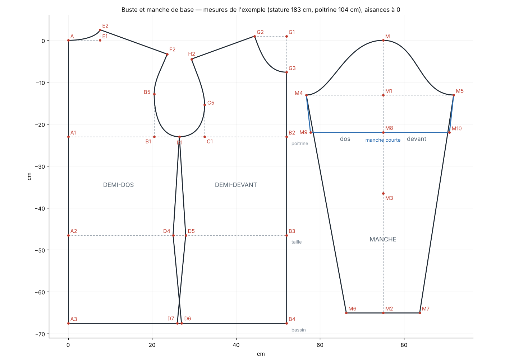

# Patron de base buste et manche homme dans Seamly2D — tutoriel pas à pas

Ce tutoriel construit, outil par outil, le patron d'exemple du dépôt : [`samples/patron.sm2d`](../../samples/patron.sm2d) et ses mesures [`samples/mesures.smis`](../../samples/mesures.smis). Il s'adresse aux débutants dans [Seamly2D](https://seamly.io) : chaque point est défini par un outil, un point parent et une formule.

Les **valeurs attendues** de chaque étape sont calculées avec les mesures de l'exemple et **toutes les aisances à 0**. Le fichier publié utilise ensuite quelques aisances (voir la [section 10](#10-réglages-du-fichier-publié)).

## Sommaire

1. [Principe de construction](#1-principe-de-construction)
2. [Mesures à saisir dans SeamlyMe](#2-mesures-à-saisir-dans-seamlyme)
3. [Variables personnalisées](#3-variables-personnalisées)
4. [Buste, étape 1 : le cadre](#4-buste-étape-1--le-cadre)
5. [Buste, étape 2 : encolures et épaules](#5-buste-étape-2--encolures-et-épaules)
6. [Buste, étape 3 : les emmanchures](#6-buste-étape-3--les-emmanchures)
7. [Buste, étape 4 : taille et bassin](#7-buste-étape-4--taille-et-bassin)
8. [Manche](#8-manche)
9. [Contrôles numériques](#9-contrôles-numériques)
10. [Réglages du fichier publié](#10-réglages-du-fichier-publié)
11. [Résultat et pièces](#11-résultat-et-pièces)

---

## 1. Principe de construction

22 points et 4 courbes pour le buste, 7 points et 2 courbes pour la manche (plus 3 points pour la manche courte), en plus des deux points de base. C'est une construction personnelle sur un cadre classique (demi-buste, milieu dos à gauche), pas la transcription d'une méthode publiée.

Trois choix la structurent :

- **Les aisances sont des variables.** Le même fichier donne le bloc sans aisance, ou une toile, un polo, une chemise, en changeant quelques valeurs.
- **La pente d'épaule est une mesure d'angle**, pas une constante proportionnelle. Elle se mesure avec un inclinomètre, par exemple un téléphone posé sur l'épaule.
- **L'emmanchure est faite de deux courbes**, dos et devant. Leurs longueurs deviennent des variables du patron, et ce sont elles qui pilotent la manche.

### État de vérification

- Le fichier publié a été construit dans Seamly2D en suivant ces étapes.
- Les longueurs de courbes calculées par Seamly2D concordent avec un calcul indépendant à 0,0001 cm près ([note de validation](../NOTE_validation_geometrie.md)).
- Le patron n'a **pas** été validé sur toile. Les constantes de forme (correction d'encolure, bascule devant, hauteur des points de tangence) sont des choix raisonnables, à corriger à l'essayage.

### Conventions

- Angles Seamly2D : 0° vers la droite, 90° vers le haut, 180° vers la gauche, 270° vers le bas.
- Unité : centimètre, dans SeamlyMe comme dans le patron.
- Séparateur décimal : selon les préférences, Seamly2D attend `0.6` ou `0,6`. Toutes les décimales sont dans les variables de la section 3 ; les formules des points n'en contiennent pas.
- Les noms de points sont uniques dans tout le fichier, tous blocs de brouillon confondus.
- Les libellés d'outils sont ceux de l'interface française. Sur une autre version ils peuvent différer : les raccourcis clavier entre parenthèses aident à les retrouver.

### Langue des formules

Ce document utilise les noms **français**, tels que l'interface française les affiche : noms de mesures traduits et préfixe `Ligne_` pour les longueurs de lignes. Les préfixes `AngleLine_`, `Spl_`, `SplPath_`, le mot `CurrentLength` et les fonctions comme `sqrt` ne sont pas traduits.

Le fichier `.sm2d` enregistre toujours les noms **anglais** (`Line_A_A1`, `bust_circ`). Un nom anglais tapé dans une formule est accepté, puis réaffiché en français. Le code à une lettre et deux chiffres (G04, I08…) est le même dans toutes les langues : c'est le repère le plus sûr.

**Interface dans une autre langue** : le tableau de la [section 2](#2-mesures-à-saisir-dans-seamlyme) donne, pour chaque mesure utilisée, son code, son nom français et son nom anglais. Remplacez dans les formules chaque nom français par le nom anglais (et `Ligne_` par `Line_`) : Seamly2D les accepte quelle que soit la langue de l'interface, et les réaffiche dans celle-ci.

## 2. Mesures à saisir dans SeamlyMe

Créez un fichier de mesures individuelles (`.smis`) en centimètres avec ces mesures. La colonne **Exemple** est une taille de prêt-à-porter pour 183 cm de stature et 104 cm de tour de poitrine : ce sont les valeurs de [`samples/mesures.smis`](../../samples/mesures.smis). Remplacez-les par vos mesures pour votre propre patron.

| Code | Nom français (formules) | Nom anglais (fichier) | Mesure | Comment la prendre | Exemple |
| --- | --- | --- | --- | --- | --- |
| G02 | cou_circ | neck_circ | Tour de cou | À la base du cou, sans serrer | 41 |
| G04 | poitrine_circ | bust_circ | Tour de poitrine | Horizontal, au plus fort | 104 |
| G07 | taille_circ | waist_circ | Tour de taille | Au creux naturel | 92 |
| G09 | hanches_circ | hip_circ | Tour de bassin | Horizontal, au plus fort des fesses | 106 |
| I08 | carrure_dos | across_back_b | Carrure dos | D'un pli de bras à l'autre, au plus étroit du dos | 41 |
| I03 | carrure_dev | across_chest_f | Carrure devant | D'un pli de bras à l'autre, au plus étroit du torse | 39 |
| I01 | épaule_longueur | shoulder_length | Longueur d'épaule | De la base latérale du cou à la pointe d'épaule | 16 |
| H36 | pente_epaule_encolure_cote | shoulder_slope_neck_side_angle | Pente d'épaule (degrés) | Angle entre la ligne cou–pointe d'épaule et l'horizontale | 20 |
| H19 | encolure_dos_taille_dos | neck_back_to_waist_b | Longueur taille dos | De la 7e cervicale à la taille | 46,5 |
| H21 | encolure_dos_sur_poitrine_dos | neck_back_to_highbust_b | Profondeur d'emmanchure | De la 7e cervicale au niveau des aisselles (règle horizontale glissée sous les bras) | 23 |
| H35 | taille_hanches_cote | waist_to_hip_side | Hauteur taille–bassin | Sur le côté | 21 |
| L05 | bras_pointe_epaule_au_poignet | arm_shoulder_tip_to_wrist | Longueur de bras | De la pointe d'épaule à l'os du poignet, bras tendu | 65 |
| L06 | bras_pointe_epaule_au_coude | arm_shoulder_tip_to_elbow | Épaule–coude | De la pointe d'épaule au coude | 36,5 |
| L11 | bras_haut_circ | arm_upper_circ | Tour de bras | Au niveau de l'aisselle | 33,5 |
| L15 | bras_poignet_circ | arm_wrist_circ | Tour de poignet | Sur l'os du poignet | 17,5 |
| L19 | tour_d'emmanchure | armscye_circ | Tour d'emmanchure | Par la pointe d'épaule et l'aisselle | 48 |

La mesure L19 ne sert à aucun tracé, seulement au contrôle de la section 9. Ne l'écrivez dans aucune formule : l'apostrophe de son nom français n'y est peut-être pas acceptée.

Deux mesures pèsent plus que les autres sur le résultat : la **profondeur d'emmanchure** et la **pente d'épaule**. Prenez-les trois fois. Faute de pouvoir mesurer seul la profondeur d'emmanchure, `poitrine_circ/10 + 12` en donne un ordre de grandeur, pas plus.

Dans Seamly2D, chargez ensuite ce fichier dans le patron (menu **Mesures**).

## 3. Variables personnalisées

Ouvrez le **Tableau des variables**, onglet **Variables personnalisées**, et créez ces 17 variables **dans cet ordre** : une variable ne peut utiliser que des mesures et des variables placées au-dessus d'elle, pas des longueurs du dessin.

| Nom | Formule | Rôle |
| --- | --- | --- |
| #ais_poitrine | 0 | Aisance totale sur le tour de poitrine (cm) |
| #ais_carrure | 0 | Aisance sur chaque demi-carrure, dos et devant |
| #ais_emm | 0 | Abaissement du fond d'emmanchure |
| #ais_poignet | 0 | Aisance totale au poignet |
| #ais_bassin | 0 | Aisance totale au bassin |
| #pente_epaule | pente_epaule_encolure_cote | Pente d'épaule, modifiable sans toucher aux mesures (degrés) |
| #embu_dos | 1 | Surlongueur de l'épaule dos, résorbée à la couture (0 en jersey, voir ci-dessous) |
| #corr_cou | 0.6 | Correction de largeur d'encolure |
| #bascule_dev | 1 | Hauteur du point d'encolure devant au-dessus du niveau de A |
| #creux_dev | 1 | Supplément de profondeur d'encolure devant |
| #div_tete | 3.5 | Diviseur de l'emmanchure donnant la hauteur de tête de manche |
| #k_tete_dos | 0.9646 | Coefficient qui rend la tête de manche dos égale à l'emmanchure dos |
| #k_tete_dev | 0.9516 | Coefficient qui rend la tête de manche devant égale à l'emmanchure devant |
| #lg_manche_courte | 22 | Longueur de la manche courte, du sommet M au bas |
| #retrait_mc | 1 | Rétrécissement du bas de la manche courte, de chaque côté |
| #exc_taille | (poitrine_circ + #ais_poitrine - taille_circ)/2 | Excédent de demi-poitrine sur demi-taille (exemple : 6) |
| #exc_bassin | (hanches_circ - poitrine_circ - #ais_poitrine)/2 | Excédent de demi-bassin sur demi-poitrine (exemple : 1) |

Seamly2D ajoute le `#` lui-même si le champ Nom le préremplit.

### Pourquoi l'épaule dos est plus longue (#embu_dos)

Le haut du dos est bombé par l'omoplate, alors que le devant est creux sous la clavicule. Le centimètre en plus donne au dos de quoi épouser ce volume.

- **En chaîne et trame**, on ne fait pas de pince pour 1 cm : on **soutient** le dos. Les deux extrémités de la couture sont épinglées bord à bord, et l'excédent du dos est réparti sur toute la longueur pendant la couture, sans pli. Une pince d'épaule ne se justifie qu'au-delà de 1,5 cm environ, pour un dos très rond.
- **En jersey**, mettez `#embu_dos = 0` : l'élasticité fait le travail, et les deux épaules ont la même longueur.

## 4. Buste, étape 1 : le cadre

Le cadre tient en 11 points, tous issus de A. Créez un nouveau patron et nommez le premier bloc de brouillon **Buste** : son point de base est **A**, la 7e cervicale, en haut à gauche.

Outils utilisés : **Point - Longueur et Angle** (L, A), **Point - Médiane sur la ligne** (Maj+O, Maj+L) et **Point - Intersection XY** (X, Y). Pour chaque ligne du tableau : sélectionnez l'outil, cliquez le parent, puis saisissez le nom, l'angle et la longueur dans la boîte de dialogue.

| Point | Outil | Parent | Angle | Longueur | Attendu (cm) | Rôle |
| --- | --- | --- | --- | --- | --- | --- |
| A1 | Longueur et Angle | A | 270 | encolure_dos_sur_poitrine_dos + #ais_emm | 23 | Ligne de poitrine, milieu dos |
| A2 | Longueur et Angle | A | 270 | encolure_dos_taille_dos | 46,5 | Ligne de taille |
| A3 | Longueur et Angle | A2 | 270 | taille_hanches_cote | 21 | Ligne de bassin |
| B1 | Longueur et Angle | A1 | 0 | carrure_dos/2 + #ais_carrure | 20,5 | Demi-carrure dos |
| B2 | Longueur et Angle | A1 | 0 | (poitrine_circ + #ais_poitrine)/2 | 52 | Milieu devant |
| C1 | Longueur et Angle | B2 | 180 | carrure_dev/2 + #ais_carrure | 19,5 | Demi-carrure devant |
| D1 | Médiane sur la ligne | B1 puis C1 | — | préremplie (CurrentLength/2) | 6 depuis B1 | Fond d'emmanchure, départ du côté |
| B5 | Longueur et Angle | B1 | 90 | Ligne_A_A1*4/9 | 10,22 | Point de tangence de l'emmanchure dos |
| C5 | Longueur et Angle | C1 | 90 | Ligne_A_A1/3 | 7,67 | Point de tangence de l'emmanchure devant |
| B3 | Intersection XY | B2 (donne X) puis A2 (donne Y) | — | — | — | Milieu devant à la taille |
| B4 | Intersection XY | B2 (donne X) puis A3 (donne Y) | — | — | — | Milieu devant au bassin |

**Contrôle immédiat** : la largeur d'emmanchure `Ligne_B1_D1 + Ligne_D1_C1` vaut 12 cm dans l'exemple. Si elle sort sous 8 ou au-dessus de 14 cm avec vos mesures, reprenez les deux carrures avant d'aller plus loin : c'est la différence de trois mesures, donc la plus sensible aux erreurs.

Le point de tangence devant est placé plus bas que celui du dos parce que l'emmanchure devant est plus creusée. Les fractions 4/9 et 1/3 sont un choix de forme, ni une convention ni une mesure : 4/9 au dos donne une courbe plus régulière que 1/2. Vous pouvez les modifier sans rien casser : la manche suit les nouvelles longueurs d'emmanchure.

## 5. Buste, étape 2 : encolures et épaules

Sept points au **Point - Longueur et Angle**, puis deux courbes. Les deux épaules partent du point d'encolure avec le même angle mesuré ; celle du dos est plus longue de `#embu_dos`.

| Point | Parent | Angle | Longueur | Attendu (cm) | Rôle |
| --- | --- | --- | --- | --- | --- |
| E1 | A | 0 | cou_circ/5 - #corr_cou | 7,6 | Largeur d'encolure dos (point de construction) |
| E2 | E1 | 90 | Ligne_A_E1/3 | 2,53 | Point d'encolure dos |
| F2 | E2 | 360 - #pente_epaule | épaule_longueur + #embu_dos | 17 | Pointe d'épaule dos |
| G1 | B2 | 90 | Ligne_A_A1 + #bascule_dev | 24 | Coin haut du milieu devant (point de construction) |
| G2 | G1 | 180 | Ligne_A_E1 | 7,6 | Point d'encolure devant |
| G3 | G1 | 270 | Ligne_A_E1 + #creux_dev | 8,6 | Creux d'encolure sur le milieu devant |
| H2 | G2 | 180 + #pente_epaule | épaule_longueur | 16 | Pointe d'épaule devant |

Pour E1 et G1, choisissez un type de ligne pointillé : ce ne sont pas des contours.

Les deux encolures se tracent avec **Courbe - Interactive** (Alt+C) : cliquez le point de départ, puis le point d'arrivée, puis ouvrez les propriétés de la courbe pour saisir les points de contrôle.

| Courbe | Départ → arrivée | 1er point de contrôle : angle | 1er : longueur | 2e point de contrôle : angle | 2e : longueur |
| --- | --- | --- | --- | --- | --- |
| Encolure dos | A → E2 | 0 | Ligne_A_E1*3/5 | AngleLine_E2_F2 - 90 | Ligne_E1_E2/2 |
| Encolure devant | G2 → G3 | AngleLine_G2_H2 + 90 | Ligne_G1_G3/2 | 180 | Ligne_G1_G2*3/5 |

Ces angles rendent chaque encolure perpendiculaire au milieu (dos ou devant) et à la couture d'épaule. Sans cela, l'encolure fait une pointe une fois les épaules cousues.

Dans l'exemple, la pointe d'épaule dos F2 se trouve à 19,7 cm au-dessus de la ligne de poitrine, et la pointe devant H2 à 18,5 cm.

## 6. Buste, étape 3 : les emmanchures

Tracez deux courbes distinctes qui se rejoignent en D1 : Seamly2D crée alors les variables `SplPath_F2_D1` (dos) et `SplPath_H2_D1` (devant), dont la manche a besoin.

Outil **Spline - Interactive** (Alt+S) : cliquez les trois points dans l'ordre, validez par Entrée, puis ouvrez les propriétés. Chaque point de la liste a un premier point de contrôle (côté arrivée) et un second (côté départ).

### Emmanchure dos : F2 → B5 → D1

| Point | 1er contrôle : angle | 1er : longueur | 2e contrôle : angle | 2e : longueur |
| --- | --- | --- | --- | --- |
| F2 | sans effet | sans effet | AngleLine_E2_F2 - 90 | Ligne_B1_B5/3 |
| B5 | 90 | Ligne_B1_B5/3 | 270 | Ligne_B1_B5/2 |
| D1 | 180 | Ligne_B1_D1*3/4 | sans effet | sans effet |

### Emmanchure devant : H2 → C5 → D1

| Point | 1er contrôle : angle | 1er : longueur | 2e contrôle : angle | 2e : longueur |
| --- | --- | --- | --- | --- |
| H2 | sans effet | sans effet | AngleLine_G2_H2 + 90 | Ligne_B1_B5/3 |
| C5 | 90 | Ligne_B1_B5/3 | 270 | Ligne_C1_C5/2 |
| D1 | 0 | Ligne_D1_C1*3/4 | sans effet | sans effet |

Ce que ces valeurs imposent : départ perpendiculaire à la couture d'épaule, passage vertical en B5 et C5 (la courbe touche la ligne de carrure sans la franchir), arrivée horizontale en D1. Les deux courbes ont la même tangente en D1 : pas de cassure sous le bras.

Longueurs attendues dans l'exemple : `SplPath_F2_D1` = 23,3 cm et `SplPath_H2_D1` = 22,4 cm. Elles se lisent dans le Tableau des variables, onglet des longueurs de courbes.

Les longueurs des poignées (1/3, 1/2, 3/4) règlent le galbe. Vous pouvez les ajuster à l'œil en gardant les angles : toute modification change les longueurs d'emmanchure, et la manche suit automatiquement.

## 7. Buste, étape 4 : taille et bassin

La couture de côté absorbe la moitié de l'excédent de taille, répartie entre dos et devant ; l'autre moitié reste en aisance. Pas de pinces : un bloc masculin destiné à un polo, une chemise ou un sweat n'en a pas besoin, et elles doubleraient le nombre de points.

Chaque point de côté est mesuré depuis le milieu (dos ou devant), ce qui garde des longueurs positives même si la taille dépasse la poitrine.

| Point | Parent | Angle | Longueur | Attendu (cm) | Rôle |
| --- | --- | --- | --- | --- | --- |
| D4 | A2 | 0 | Ligne_A1_B1 + Ligne_B1_D1 - #exc_taille/4 | 25 | Côté dos à la taille |
| D5 | B3 | 180 | Ligne_B2_C1 + Ligne_D1_C1 - #exc_taille/4 | 24 | Côté devant à la taille |
| D6 | A3 | 0 | Ligne_A1_B1 + Ligne_B1_D1 + #exc_bassin/2 + #ais_bassin/4 | 27 | Côté dos au bassin |
| D7 | B4 | 180 | Ligne_B2_C1 + Ligne_D1_C1 + #exc_bassin/2 + #ais_bassin/4 | 26 | Côté devant au bassin |

Avec **Ligne entre 2 points** (Alt+L), tracez D1–D4 et D4–D6 pour le dos, D1–D5 et D5–D7 pour le devant.

- Dans l'exemple, le demi-tour de taille du patron vaut 25 + 24 = 49 cm pour 46 cm mesurés : il reste 6 cm d'aisance sur le tour complet. Au bassin, le patron fait exactement le tour mesuré, plus `#ais_bassin`.
- Les deux côtés se croisent sous la taille quand le bassin dépasse la poitrine. C'est normal : dos et devant sont deux pièces séparées.
- Pour un bloc vraiment ajusté à la taille, remplacez `/4` par `/2` dans D4 et D5. Le côté devient alors très cintré ; au-delà, il faut des pinces dos.

## 8. Manche

La manche se déduit entièrement des deux longueurs d'emmanchure : 7 points et 2 courbes. Créez un **Nouveau bloc de brouillon** (Ctrl+Maj+N) nommé **Manche**, dans le même fichier, et placez son point de base **M** (sommet de la tête de manche) à droite du buste, par exemple 80 cm à droite de A, à peu près à la même hauteur (75 cm sur la figure de la section 11). Cette position est libre et n'entre dans aucune formule. Le dos de la manche est à gauche.

| Point | Parent | Angle | Longueur | Attendu (cm) | Rôle |
| --- | --- | --- | --- | --- | --- |
| M1 | M | 270 | (SplPath_F2_D1 + SplPath_H2_D1)/#div_tete | 13,04 | Hauteur de tête, ligne de dessous de bras |
| M2 | M | 270 | bras_pointe_epaule_au_poignet | 65 | Ligne de poignet |
| M3 | M | 270 | bras_pointe_epaule_au_coude | 36,5 | Repère de coude |
| M4 | M1 | 180 | sqrt((SplPath_F2_D1*#k_tete_dos)^2 - Ligne_M_M1^2) | 18,27 | Dessous de bras, côté dos |
| M5 | M1 | 0 | sqrt((SplPath_H2_D1*#k_tete_dev)^2 - Ligne_M_M1^2) | 16,83 | Dessous de bras, côté devant |
| M6 | M2 | 180 | (bras_poignet_circ + #ais_poignet)/2 | 8,75 | Poignet, côté dos |
| M7 | M2 | 0 | (bras_poignet_circ + #ais_poignet)/2 | 8,75 | Poignet, côté devant |

La formule de M4 est un **théorème de Pythagore** : la distance en ligne droite de M à M4 vaut la longueur de l'emmanchure dos multipliée par `#k_tete_dos`. Ce coefficient compense le surplus de longueur de la courbe sur sa corde : la tête de manche dos a ainsi la même longueur que l'emmanchure dos, quelles que soient les mesures. Même principe pour M5 au devant.

À longueurs égales, la largeur de manche ne dépend plus que de la hauteur de tête, donc de `#div_tete`. Les trois variables se changent ensemble, selon ce tableau :

| #div_tete | #k_tete_dos | #k_tete_dev | Hauteur de tête (exemple) | Largeur de manche (exemple) |
| --- | --- | --- | --- | --- |
| 3 | 0.9585 | 0.9454 | 15,2 cm | 31,0 cm |
| 3.5 | 0.9646 | 0.9516 | 13,0 cm | 35,1 cm |
| 4 | 0.9705 | 0.9588 | 11,4 cm | 37,7 cm |
| 5 | 0.9793 | 0.9705 | 9,1 cm | 40,6 cm |

Une tête haute donne une manche étroite et près du corps ; une tête basse, une manche large et mobile. Ces coefficients ne dépendent pas de la taille, mais ils ne valent que pour les longueurs de poignées données ci-dessous.

Les deux moitiés de la tête se tracent avec **Courbe - Interactive** (Alt+C) :

| Courbe | Départ → arrivée | 1er contrôle : angle | 1er : longueur | 2e contrôle : angle | 2e : longueur | Longueur attendue |
| --- | --- | --- | --- | --- | --- | --- |
| Tête dos (Spl_M4_M) | M4 → M | 0 | Ligne_M1_M4/3 | 180 | Ligne_M1_M4/2 | 23,28 cm |
| Tête devant (Spl_M_M5) | M → M5 | 0 | Ligne_M1_M5/2 | 180 | Ligne_M1_M5/2 | 22,38 cm |

Les poignées horizontales aux deux bouts donnent à chaque moitié sa forme en S, sans point intermédiaire. La poignée basse plus longue au devant creuse davantage l'avant de la tête, comme le veut l'anatomie.

Terminez par deux **Lignes entre 2 points** : M4–M6 et M5–M7.

### Manche courte

La manche courte réutilise la tête de manche : trois points de plus dans le même bloc Manche, au **Point - Longueur et Angle**.

| Point | Parent | Angle | Longueur | Attendu (cm) | Rôle |
| --- | --- | --- | --- | --- | --- |
| M8 | M | 270 | #lg_manche_courte | 22 | Ligne de bas de la manche courte |
| M9 | M8 | 180 | Ligne_M1_M4 - #retrait_mc | 17,27 | Bas, côté dos |
| M10 | M8 | 0 | Ligne_M1_M5 - #retrait_mc | 15,83 | Bas, côté devant |

Tracez ensuite deux **Lignes entre 2 points** : M4–M9 et M5–M10. Les deux coutures de dessous de bras ont la même longueur par construction.

- Dans l'exemple, le bas mesure 33,1 cm et le dessous de bras 9 cm.
- `#lg_manche_courte` doit rester supérieure à la hauteur de tête `Ligne_M_M1` (13 cm dans l'exemple), sinon M8 passe au-dessus de la ligne de dessous de bras.
- La bonne valeur se lit sur un t-shirt qui vous va : du haut de la couture d'épaule au bas de la manche.
- À la coupe, la valeur d'ourlet doit s'évaser en miroir des coutures (plus large au bord qu'à la pliure), sinon l'ourlet replié est trop étroit.

## 9. Contrôles numériques

Cinq contrôles suffisent à valider le tracé avant de couper quoi que ce soit. Les valeurs se lisent dans le Tableau des variables (longueurs des lignes, longueurs des courbes) ; le calcul se fait à la main ou dans l'assistant de formule de n'importe quel outil.

| Contrôle | Calcul | Exemple | Cible | Si hors cible |
| --- | --- | --- | --- | --- |
| Encolure | Spl_A_E2 + Spl_G2_G3 - cou_circ/2 | +0,2 cm | 0 à +0,5 cm | Augmenter #corr_cou de 0,1 raccourcit la demi-encolure d'environ 0,26 cm |
| Tête de manche, dos | Spl_M4_M - SplPath_F2_D1 | 0,0 cm | 0 ± 0,1 cm | Vérifier #k_tete_dos et les poignées de la tête dos |
| Tête de manche, devant | Spl_M_M5 - SplPath_H2_D1 | 0,0 cm | 0 ± 0,1 cm | Vérifier #k_tete_dev et les poignées de la tête devant |
| Largeur de manche | Ligne_M1_M4 + Ligne_M1_M5 - bras_haut_circ | +1,6 cm | ≥ 0 en chaîne et trame | Passer à la ligne suivante du tableau de #div_tete |
| Emmanchure | SplPath_F2_D1 + SplPath_H2_D1, comparé à la mesure L19 | 45,7 cm | du même ordre | Reprendre la profondeur d'emmanchure et les carrures |

- **Tête de manche.** L'égalité avec l'emmanchure est construite, pas réglée : si le contrôle sort de ±0,1 cm, une valeur est mal saisie. Pour donner de l'embu à une manche montée en chaîne et trame, augmentez les deux coefficients : chaque +0,01 ajoute environ 0,25 cm par côté.
- **Emmanchure.** L'écart exact à attendre entre l'emmanchure tracée sans aisance et le tour d'emmanchure L19 mesuré sur le corps n'est pas connu. Un écart de plus de 3 cm mérite de reprendre les mesures ; en dessous, c'est l'essai sur toile qui tranche.

## 10. Réglages du fichier publié

Le fichier [`samples/patron.sm2d`](../../samples/patron.sm2d) suit exactement cette construction, avec des **aisances de toile** (essai en calicot, aisance minimale) à la place des zéros :

| Variable | Tutoriel | Fichier publié |
| --- | --- | --- |
| #ais_poitrine | 0 | 6 |
| #ais_carrure | 0 | 0.5 |
| #ais_emm | 0 | 1.5 |
| #ais_bassin | 0 | 6 |
| #embu_dos | 1 | 0 |

Toutes les autres variables et toutes les formules sont identiques. Avec ces réglages, le fichier publié donne notamment :

| Grandeur | Aisances à 0 | Fichier publié |
| --- | --- | --- |
| A–A1 (profondeur d'emmanchure) | 23 cm | 24,5 cm |
| A1–B2 (demi-poitrine) | 52 cm | 55 cm |
| Emmanchure dos / devant (`SplPath_F2_D1` / `SplPath_H2_D1`) | 23,28 / 22,38 cm | 25,37 / 24,40 cm |
| Hauteur de tête `Ligne_M_M1` | 13,04 cm | 14,22 cm |
| Largeur de manche − tour de bras | +1,6 cm | +4,8 cm |
| Milieu dos A–A3 | 67,5 cm | 67,5 cm |

Ces valeurs ont été vérifiées par le calcul de CutLayout, qui concorde avec Seamly2D ([note de validation](../NOTE_validation_geometrie.md)).

## 11. Résultat et pièces

La figure ci-dessous est le tracé calculé avec les formules de ce document et les mesures de l'exemple, **toutes aisances à 0**. La manche courte est en bleu. L'écran de Seamly2D doit montrer la même disposition de points ; les proportions changent avec les mesures et les aisances.

### Extraire les pièces

En **Mode Pièce**, outil **Ajouter une nouvelle pièce de patron** (N, P) : cliquez les points et les courbes du contour dans le sens horaire, puis Entrée.

| Pièce | Contour, dans l'ordre |
| --- | --- |
| Demi-dos (au pli) | A, encolure dos, E2, F2, emmanchure dos, D1, D4, D6, A3 |
| Demi-devant (au pli) | G2, encolure devant, G3, B4, D7, D5, D1, emmanchure devant, H2 |
| Manche longue | M4, tête dos, M, tête devant, M5, M7, M6 |
| Manche courte | M4, tête dos, M, tête devant, M5, M10, M9 |

L'emmanchure devant est tracée de H2 vers D1, mais parcourue ici de D1 vers H2 : **inversez cette courbe** dans la liste des nœuds de la pièce, sinon le contour se croise.

Dans les options des pièces Demi-dos et Demi-devant, cochez **au pli** : ce sont des demi-pièces, à poser milieu sur la pliure du tissu. La manche se coupe en deux exemplaires, en miroir.

Pour imprimer ces pièces à l'échelle 1:1, ouvrez le patron dans CutLayout : voir le [tutoriel de CutLayout](../tutoriel/README.md).
