# Tutoriel CutLayout

CutLayout imprime à l'échelle 1:1 les pièces d'un patron [Seamly2D](https://seamly.io), en mosaïque de feuilles A4 (ou d'un autre format) à découper et à assembler.

Ce tutoriel suit un exemple complet, du patron au plan de coupe imprimé, puis détaille chaque fonction.

> Les illustrations sont faites avec le **patron de démonstration** fourni dans [`demo/`](demo/) : une jupe droite simplifiée avec des mesures **fictives**. Ouvrez-le pour refaire chaque étape vous-même.

## Sommaire

1. [Principe](#1-principe)
2. [Installation et lancement](#2-installation-et-lancement)
3. [Premier plan de coupe pas à pas](#3-premier-plan-de-coupe-pas-à-pas)
4. [La fenêtre principale](#4-la-fenêtre-principale)
5. [Placer les pièces](#5-placer-les-pièces)
6. [Contrôles : chevauchement et hors du plan](#6-contrôles--chevauchement-et-hors-du-plan)
7. [Annuler et rétablir](#7-annuler-et-rétablir)
8. [Mise en page : format, orientation, marges](#8-mise-en-page--format-orientation-marges)
9. [Exporter le PDF](#9-exporter-le-pdf)
10. [Imprimer et assembler](#10-imprimer-et-assembler)
11. [Calibrer l'imprimante](#11-calibrer-limprimante)
12. [Enregistrer et rouvrir un plan de coupe](#12-enregistrer-et-rouvrir-un-plan-de-coupe)
13. [Préférences](#13-préférences)
14. [Affichage : thème et langue](#14-affichage--thème-et-langue)
15. [Ce que CutLayout lit dans un patron Seamly2D](#15-ce-que-cutlayout-lit-dans-un-patron-seamly2d)
16. [Raccourcis clavier](#16-raccourcis-clavier)
17. [Limites connues](#17-limites-connues)

---

## 1. Principe

```
patron.sm2d ─┐
             ├─► CutLayout ─► placement des pièces ─► PDF 1:1 en mosaïque ─► impression ─► assemblage
mesures.smis ┘                                          + plan de montage
```

- CutLayout **recalcule** chaque pièce à partir des formules du patron (`.sm2d`) et des mesures individuelles (`.smis`), comme le fait Seamly2D.
- Les pièces sont imprimées en **contour net**, sans marge de couture.
- Vous placez les pièces sur un plan. CutLayout le découpe en feuilles, ajoute une page de **plan de montage**, et produit un PDF dont chaque feuille est **exactement à l'échelle 1:1**.
- Un **plan de coupe** (`.cutl`) enregistre la position des pièces pour le retrouver plus tard.

Unités : CutLayout travaille en millimètres. L'écran affiche les cotes en centimètres.

## 2. Installation et lancement

### 2.1 Application prête à l'emploi (Windows)

CutLayout est livré en **application portable** : un dossier à dézipper, sans installation et sans Python.

1. Dézipper `CutLayout-<version>-windows.zip` où vous voulez : bureau, dossier personnel, clé USB, partage réseau…
2. Lancer **`CutLayout\CutLayout.exe`**.

Pour ouvrir directement un plan de coupe ou un patron, glissez le fichier sur `CutLayout.exe`, ou utilisez **Ouvrir avec…** dans l'explorateur.

> Au premier lancement d'un programme téléchargé et non signé, Windows peut afficher « Windows a protégé votre ordinateur ». Cliquer sur **Informations complémentaires**, puis **Exécuter quand même**.

Les **préférences** ne sont pas dans le dossier de l'application, mais dans votre compte : `C:\Users\<nom>\.cut_layout\config.ini`. Remplacer le dossier par une nouvelle version les conserve donc.

macOS et Linux : le même script de build fonctionne, mais il doit être lancé **sur** chaque système (voir 2.3). Ces versions n'ont pas encore été construites ni essayées.

### 2.2 Depuis les sources (développement)

Python 3.10 est nécessaire.

```powershell
py -3.10 -m venv .venv
.venv\Scripts\python -m pip install -e ".[dev]"
```

Lancement :

```powershell
.venv\Scripts\cut-layout                       # fenêtre vide
.venv\Scripts\cut-layout jupe_demo.sm2d        # ouvre un patron
.venv\Scripts\cut-layout jupe.cutl             # ouvre un plan de coupe enregistré
```

### 2.3 Construire l'application portable

```powershell
.venv\Scripts\python -m pip install -e ".[build]"
.venv\Scripts\python pyinstaller_build.py
```

Résultat dans `pyinstaller_dist/` : le dossier `CutLayout/` et le zip `CutLayout-<version>-windows.zip`. Sous macOS et Linux, la même commande produit `CutLayout-<version>-macos.zip` ou `-linux.zip` : PyInstaller ne construit que pour le système sur lequel il tourne.

## 3. Premier plan de coupe pas à pas

### 3.1 Ouvrir le patron

**Fichier > Ouvrir un patron…** (`Ctrl+O`), puis choisir `docs/tutoriel/demo/jupe_demo.sm2d`.

Le patron indique quel fichier de mesures il utilise. CutLayout le propose :

- **Utiliser** : prend le fichier de mesures déclaré par le patron (ici `mesures_demo.smis`) ;
- **Choisir un autre…** : pour prendre d'autres mesures, par exemple celles d'une autre personne.

Si le fichier déclaré est introuvable, CutLayout le signale et demande d'en choisir un.

> Le patron et les mesures doivent utiliser la **même unité** (cm ou mm). Sinon l'import est refusé.

### 3.2 Choisir les pièces

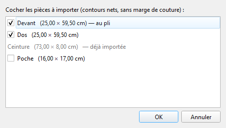

Cochez les pièces à placer. Chaque ligne donne les dimensions de la pièce (contour net) et la mention **au pli** si le patron le précise. Une pièce déjà sur le plan est grisée (« déjà importée »).

Les pièces arrivent côte à côte, de gauche à droite, à partir de l'origine, avec un écart de 2 cm et sans rotation. Vous les déplacez ensuite (section 5).

Pour ajouter plus tard une pièce oubliée : **Pièce > Ajouter des pièces…**

### 3.3 Placer, contrôler, exporter

1. Déplacer les pièces à la souris, ou les régler précisément dans leurs **propriétés** (double-clic).
2. Vérifier qu'aucune pièce n'est en **magenta** (chevauchement) ni en **rouge** (hors du plan).
3. **Fichier > Exporter le PDF…** (`Ctrl+E`).
4. Imprimer **à 100 %**, découper chaque feuille sur son cadre en pointillés, assembler en suivant le plan de montage.
5. **Fichier > Enregistrer le plan de coupe** (`Ctrl+S`) pour le retrouver plus tard.

## 4. La fenêtre principale

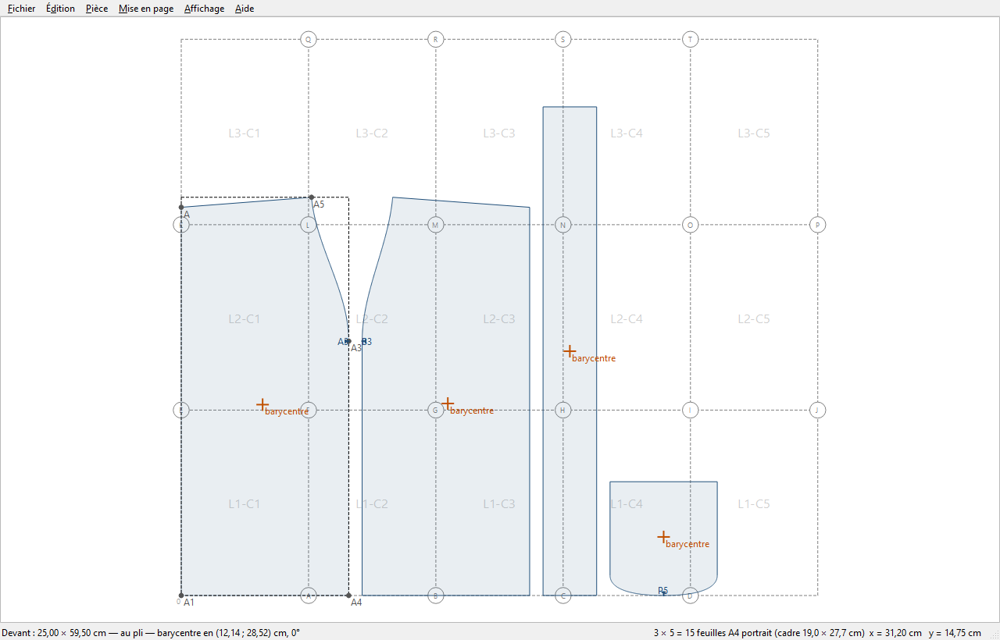

| Élément | Rôle |
| --- | --- |
| **Origine** « 0 » (en bas à gauche) | Point (0 ; 0) du plan. **x vers la droite, y vers le haut.** Le plan imprimé commence ici. |
| **Grille en pointillés** | Les feuilles du PDF. Chaque case est le **cadre de coupe** d'une feuille, repérée **L***ligne***-C***colonne* (L1-C1 en bas à gauche). La grille s'ajuste automatiquement au plus petit nombre de feuilles qui couvre toutes les pièces. |
| **Lettres dans des cercles** | Coins communs à plusieurs feuilles. À l'assemblage, les coins de même lettre se rejoignent. |
| **Croix orange** | Point de référence de la pièce (par défaut son **barycentre**). Position et rotation se règlent par rapport à ce point. |
| **Pièce sélectionnée** | Cadre en pointillés (boîte englobante) et **nœuds** nommés (A, A5, A3…). |
| **Barre d'état, à gauche** | Pièce sélectionnée : dimensions, au pli, point de référence et position, rotation, et les alertes « retournée », « HORS DU PLAN », « CHEVAUCHE … ». |
| **Barre d'état, à droite** | Nombre de feuilles, format et taille du cadre de coupe, puis position de la souris sur le plan, en cm. |

### Souris

| Geste | Effet |
| --- | --- |
| Clic sur une pièce | La sélectionne (nœuds visibles) |
| Glisser une pièce | La déplace (position arrondie à 0,1 mm) |
| Double-clic sur une pièce | Ouvre ses propriétés |
| Glisser dans le vide | Déplace la vue |
| Molette | Zoom autour du pointeur |
| `Ctrl+0` | Tout afficher |

### Menus

| Fichier | Édition | Pièce | Mise en page | Affichage | Aide |
| --- | --- | --- | --- | --- | --- |
| 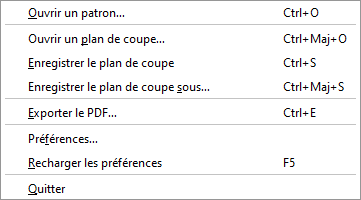 | 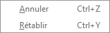 | 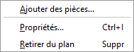 | 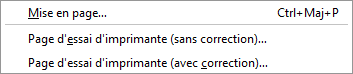 | 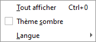 |  |

## 5. Placer les pièces

### 5.1 À la souris

Glissez la pièce. Une entrée d'annulation est créée au relâchement (« Déplacer Devant »). Un simple clic ne déplace pas la pièce.

### 5.2 Fenêtre Propriétés

Double-clic sur la pièce, ou **Pièce > Propriétés…** (`Ctrl+I`).

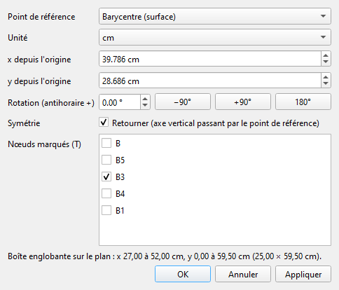

| Champ | Rôle |
| --- | --- |
| **Point de référence** | **Barycentre (surface)** ou n'importe quel **nœud** de la pièce. Changer de point de référence ne déplace pas la pièce : x et y sont recalculés. Pratique pour poser un nœud précis à une cote précise, par exemple le milieu devant sur x = 0. |
| **Unité** | cm ou mm, pour la saisie. Résolution : 0,01 mm. |
| **x, y depuis l'origine** | Position du point de référence sur le plan. |
| **Rotation (antihoraire +)** | Angle en degrés autour du point de référence. Positif = sens inverse des aiguilles d'une montre. Boutons **−90°**, **+90°**, **180°**. |
| **Symétrie** | **Retourner** la pièce par rapport à l'axe vertical qui passe par le point de référence (voir 5.3). |
| **Nœuds marqués (T)** | Nœuds du contour à repérer par un T (voir 5.4). |
| Boîte englobante | Position de la pièce sur le plan, avec une alerte en rouge si une partie sort du plan. |

- **Appliquer** : applique sans fermer, pour voir le résultat.
- **OK** : applique et ferme.
- **Annuler** : ferme sans rien changer de plus. Ce qui a déjà été appliqué reste, mais peut être annulé avec `Ctrl+Z`.

Les valeurs affichées sont arrondies, mais CutLayout garde les valeurs exactes. Un champ que vous ne modifiez pas ne change pas la position.

### 5.3 Retourner une pièce (symétrie)

La case **Retourner** fait de la pièce son image miroir, autour de l'axe vertical qui passe par le point de référence. Le point de référence ne bouge pas. Si la pièce était tournée, l'angle change de signe (30° devient −30°) : la pièce reste visuellement dans la même direction, simplement retournée.

Dans l'exemple, le **Dos** est retourné pour poser son côté face au côté du Devant.

Si le patron Seamly2D **interdit le retournement** de la pièce (option de la pièce dans Seamly2D), la case est grisée. C'est le cas de la Ceinture du patron de démonstration. Une pièce déjà retournée peut toujours être remise à l'endroit.

### 5.4 Nœuds marqués : repères en T

Cochez un ou plusieurs nœuds dans **Nœuds marqués (T)**. Chacun reçoit un **T** :

- la tige part du nœud, perpendiculaire au contour, **vers l'intérieur** de la pièce (5 mm) ;
- la barre (4 mm) est au bout de la tige ;
- le nom du nœud est écrit à côté.

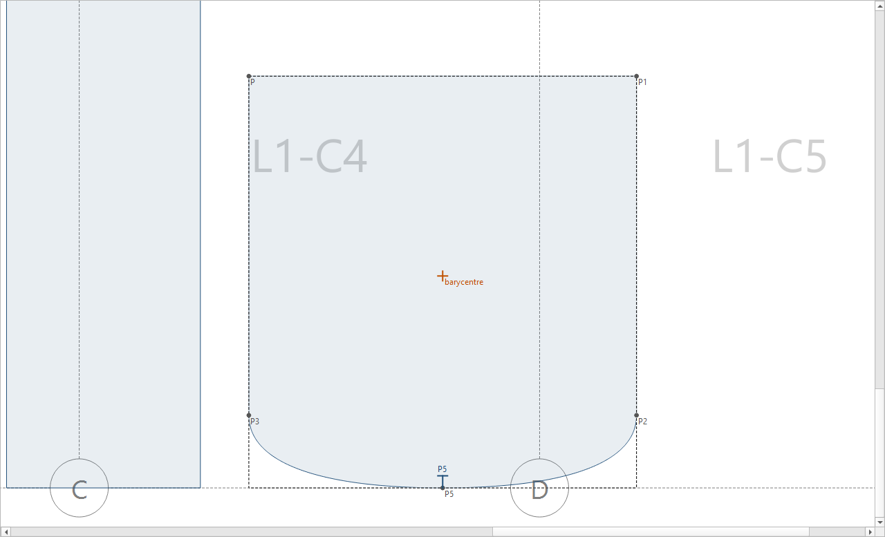

*Poche sélectionnée : nœuds P à P5, repère en T sur P5 au milieu du fond arrondi.*

Les T servent de repères de montage : hauteur des hanches, crans, milieu d'une courbe… Sur un angle (par exemple un coin), la tige suit la bissectrice. Les T sont imprimés dans le PDF avec le même trait que le contour, et suivent la rotation et la symétrie de la pièce.

Pour marquer un point qui n'est pas un nœud de la pièce, ajoutez-le d'abord comme nœud de la pièce dans Seamly2D.

### 5.5 Retirer une pièce

Sélectionnez-la puis **Pièce > Retirer du plan** (`Suppr`). Elle peut être remise par **Pièce > Ajouter des pièces…**, ou par `Ctrl+Z`.

## 6. Contrôles : chevauchement et hors du plan

| Couleur | Signification |
| --- | --- |
| **Magenta** | La pièce **chevauche** une autre pièce (surface commune de plus de 1 mm²). Deux pièces simplement bord à bord ne sont pas signalées. |
| **Rouge** | Une partie de la pièce est **hors du plan** (x ou y négatif). Cette partie ne serait pas imprimée. |

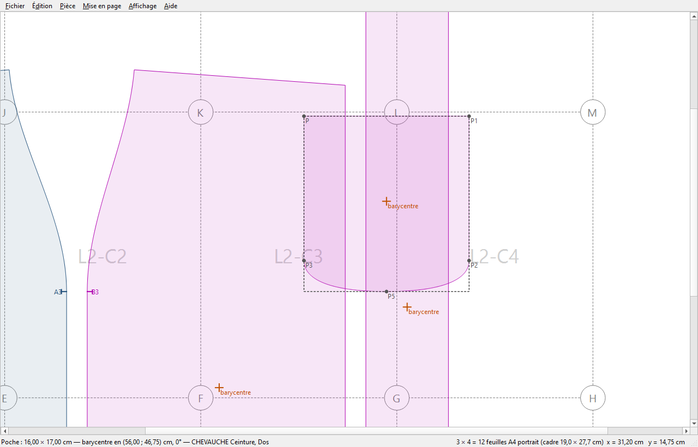

*La Poche posée sur le Dos et la Ceinture : les trois pièces passent en magenta, la barre d'état indique « CHEVAUCHE Ceinture, Dos ».*

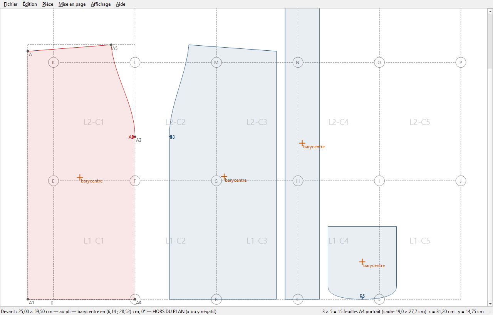

*Le Devant dépasse à gauche de l'origine : il passe en rouge, la barre d'état indique « HORS DU PLAN ».*

La couleur change pendant le glisser. À l'export, CutLayout avertit et demande confirmation si une pièce chevauche ou sort du plan.

## 7. Annuler et rétablir

**Édition > Annuler** (`Ctrl+Z`) et **Rétablir** (`Ctrl+Y` ou `Ctrl+Maj+Z`). Le menu indique l'action concernée, par exemple « Annuler Déplacer Dos ».

Ce qui s'annule :

- un déplacement à la souris ;
- chaque **Appliquer** ou **OK** de la fenêtre Propriétés qui a changé quelque chose (position, rotation, symétrie, T) ;
- l'ajout et le retrait de pièces ;
- un changement de mise en page.

L'historique est vidé quand on ouvre un autre patron ou un autre plan de coupe.

## 8. Mise en page : format, orientation, marges

**Mise en page > Mise en page…** (`Ctrl+Maj+P`)

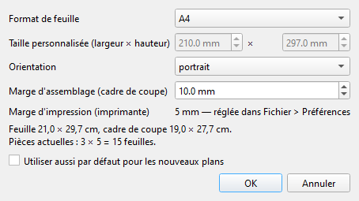

| Réglage | Valeurs |
| --- | --- |
| **Format de feuille** | A4, A3, A2, A1, A0, US Letter, US Legal, Tabloid, **Personnalisé** |
| **Taille personnalisée** | Largeur × hauteur en mm (50 à 5000 mm par côté), active seulement pour « Personnalisé ». Le petit côté est toujours la largeur en portrait, quel que soit l'ordre de saisie. |
| **Orientation** | portrait ou paysage |
| **Marge d'assemblage** | Distance du bord de la feuille au **cadre de coupe** en pointillés (10 mm par défaut) |
| **Marge d'impression** | Zone que l'imprimante ne peut pas imprimer. Affichée ici, réglée dans les préférences (c'est un réglage de l'imprimante, pas du plan). |

La fenêtre calcule aussitôt la taille du cadre de coupe et le **nombre de feuilles** nécessaires pour les pièces actuelles. Une valeur impossible (marge d'impression plus grande que la marge d'assemblage, par exemple) s'affiche en rouge et le bouton OK est grisé.

- La mise en page est **propre au plan** et enregistrée dans le `.cutl`.
- Cochez **Utiliser aussi par défaut pour les nouveaux plans** pour l'écrire aussi dans les préférences.

### Les marges

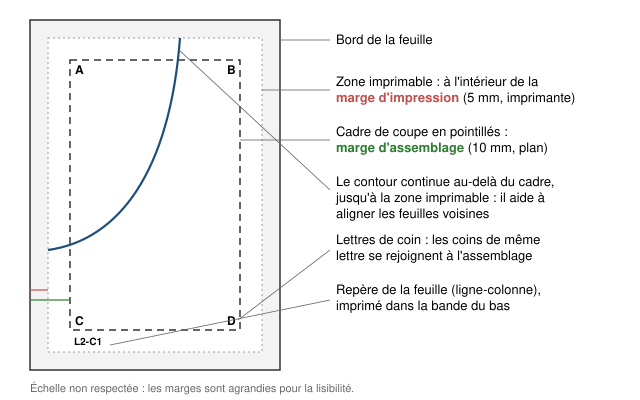

- La **marge d'impression** (préférences) doit être au moins égale à la zone non imprimable de l'imprimante : mesurez-la avec la page d'essai (section 11).
- La **marge d'assemblage** doit être plus grande que la marge d'impression. Entre les deux, le contour des pièces continue d'être imprimé au-delà du cadre de coupe. Cette bande aide à aligner les feuilles voisines, puis part avec la chute.

## 9. Exporter le PDF

**Fichier > Exporter le PDF…** (`Ctrl+E`). Le nom proposé est `<patron>_plan_de_coupe.pdf`, dans le dossier du patron.

À la fin, un résumé indique le nombre de pages, les pages vides omises et la correction d'imprimante appliquée. Le bouton **Ouvrir le PDF** affiche le résultat.

### Page 1 : plan de montage

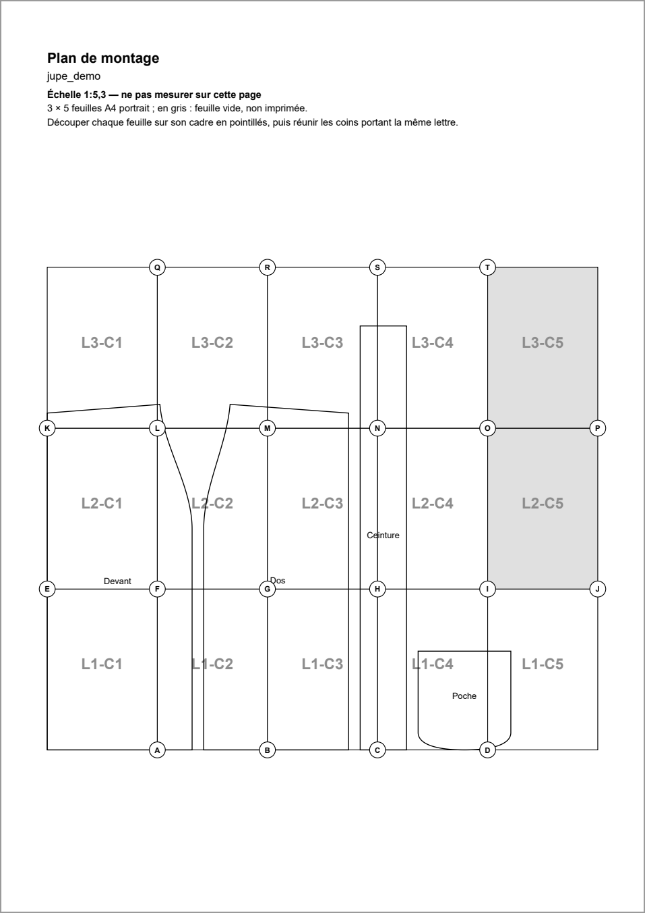

- Vue d'ensemble **réduite** (échelle indiquée, ici 1:5,3) : **ne pas mesurer sur cette page**.
- Grille des feuilles avec leur repère (L1-C1…), lettres des coins, nom des pièces.
- Les feuilles **grisées** sont vides : elles ne sont pas imprimées.

### Pages suivantes : les feuilles à l'échelle 1:1

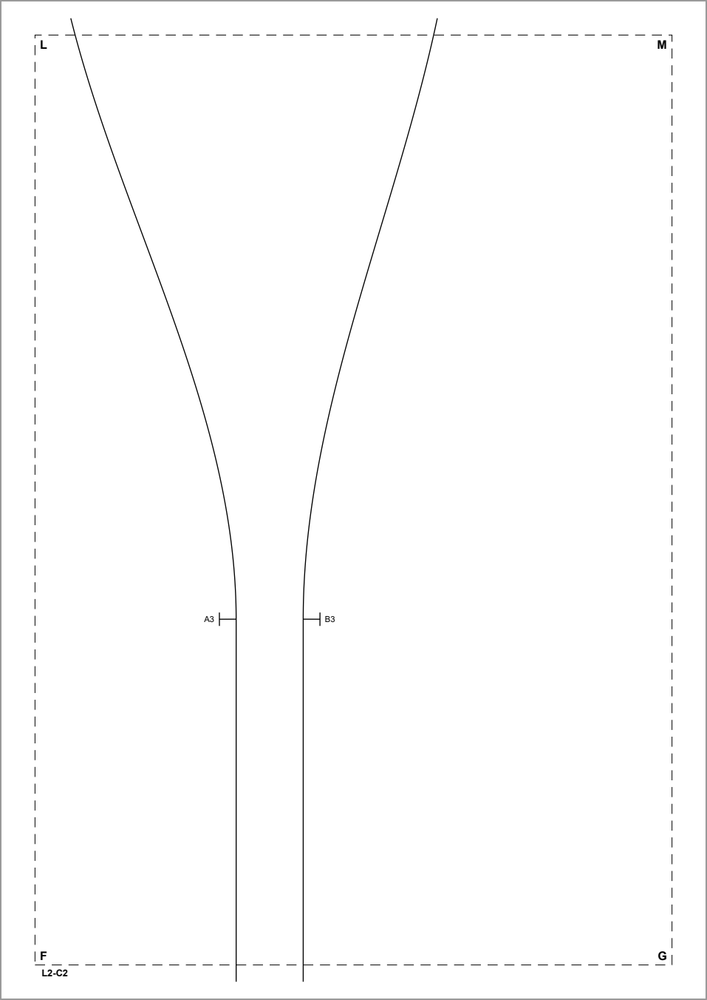

*Feuille L2-C2 : côtés du Devant et du Dos, avec les T des nœuds A3 et B3.*

- Les feuilles se suivent **ligne par ligne**, à partir de L1-C1 en bas à gauche. Les feuilles vides sont omises.
- **Cadre de coupe** en pointillés, **lettres de coin** à l'intérieur du cadre, **repère** de la feuille dans la bande du bas.
- Contour des pièces (trait de 0,3 mm) et repères en T.
- La correction d'échelle de l'imprimante (section 11) est appliquée à chaque feuille.

## 10. Imprimer et assembler

1. Imprimer **à 100 % / taille réelle**. Désactiver tout « Ajuster à la page » ou « Réduire les pages trop grandes » dans la fenêtre d'impression. Avec un mauvais réglage, toute l'échelle est fausse.
2. **Contrôle rapide** : mesurer le cadre de coupe d'une feuille avec une règle (A4 portrait : 190 × 277 mm). Cela suffit à repérer un mauvais réglage d'impression.
3. Découper chaque feuille **sur son cadre en pointillés**.
4. Assembler bord à bord en suivant le plan de montage : les **coins de même lettre** se rejoignent, et le contour doit continuer sans décalage d'une feuille à l'autre.
5. Pour un patron important, mesurer une **grande cote qui traverse plusieurs jonctions** (par exemple la longueur d'une pièce) et la comparer au patron : cela contrôle aussi la précision de l'assemblage.

## 11. Calibrer l'imprimante

Une imprimante n'imprime pas toujours exactement à 100 % : quelques dixièmes de pour cent d'écart donnent plusieurs millimètres sur une pièce de 70 cm. CutLayout compense cet écart, mesuré une fois pour toutes pour une imprimante, un bac et un papier.

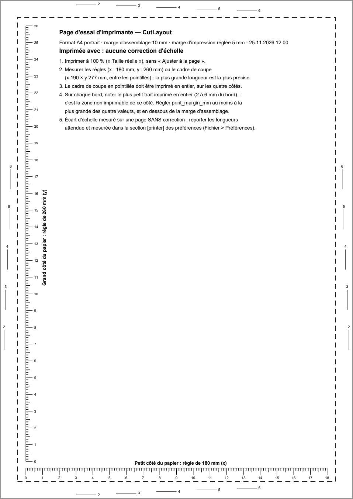

### 11.1 Mesurer l'écart

1. **Mise en page > Page d'essai d'imprimante (sans correction)…** et imprimer à 100 %.
2. Sur la page imprimée, mesurer :
   - la **règle horizontale** (x, petit côté du papier : 180 mm) et la **règle verticale** (y, grand côté : 260 mm),
   - ou mieux, le **cadre de coupe** (A4 : 190 × 277 mm) : la plus grande longueur donne la correction la plus précise.
3. Sur chaque bord, noter le plus petit trait imprimé **en entier** (2 à 6 mm du bord) : c'est la zone non imprimable de ce côté.

### 11.2 Saisir la correction

**Fichier > Préférences…** ouvre le fichier de préférences dans l'éditeur de texte. Dans la section `[printer]`, indiquer pour chaque axe la longueur **attendue** et la longueur **mesurée** :

```ini
[printer]
x_expected_mm = 190
x_measured_mm = 188.8
y_expected_mm = 277
y_measured_mm = 276.7
```

Régler aussi `print_margin_mm` (section `[sheet]`) au moins à la plus grande des quatre valeurs du point 3.

Enregistrer le fichier, puis **Fichier > Recharger les préférences** (`F5`).

### 11.3 Vérifier

**Mise en page > Page d'essai d'imprimante (avec correction)…**, imprimer, mesurer : les règles doivent faire 180 et 260 mm.

- La correction vaut en **portrait comme en paysage** : en paysage, CutLayout tient compte de la rotation de la feuille dans l'imprimante.
- Elle est limitée à ±5 %. Au-delà, il s'agit probablement d'une erreur de saisie.
- Pour une **autre imprimante, un autre bac ou un autre papier**, refaire la mesure.

## 12. Enregistrer et rouvrir un plan de coupe

- **Fichier > Enregistrer le plan de coupe** (`Ctrl+S`) et **Enregistrer le plan de coupe sous…** (`Ctrl+Maj+S`) créent un fichier **`.cutl`**.
- **Fichier > Ouvrir un plan de coupe…** (`Ctrl+Maj+O`) le rouvre. Les anciens fichiers `.pdc` restent lisibles.

Le `.cutl` contient :

- le chemin du patron et des mesures, relatif au dossier du `.cutl` (gardez-les ensemble) ;
- une empreinte de ces deux fichiers ;
- la mise en page ;
- pour chaque pièce : point de référence, position, rotation, symétrie, nœuds marqués.

Il ne contient **ni les contours ni les mesures** : les pièces sont recalculées à chaque ouverture. Ainsi :

- si le patron ou les mesures ont été **modifiés** depuis l'enregistrement, CutLayout le signale. Si vous confirmez, les pièces sont recalculées aux positions enregistrées : vérifiez ensuite les chevauchements ;
- une pièce disparue du patron est signalée et ignorée, de même qu'un nœud marqué disparu.

À la fermeture, ou avant d'ouvrir un autre patron ou plan, CutLayout propose d'enregistrer les modifications.

## 13. Préférences

**Fichier > Préférences…** ouvre `config.ini` dans l'éditeur de texte par défaut. Le fichier se trouve dans le compte de l'utilisateur : `C:\Users\<nom>\.cut_layout\config.ini`. Chaque réglage est précédé d'un commentaire qui liste les valeurs possibles.

Après modification : **Fichier > Recharger les préférences** (`F5`). Une valeur invalide est signalée, avec la liste des valeurs acceptées.

| Section | Réglages |
| --- | --- |
| `[sheet]` | Mise en page par défaut des nouveaux plans : `format`, `orientation`, `assembly_margin_mm`, `custom_width_mm`, `custom_height_mm`. Et la marge de l'imprimante : `print_margin_mm`. |
| `[display]` | `theme` (`light` ou `dark`), `language` (`auto`, `en`, `fr`) |
| `[printer]` | Correction d'échelle : `x_expected_mm`, `x_measured_mm`, `y_expected_mm`, `y_measured_mm` (section 11) |

Les décimales s'écrivent avec un point ou une virgule.

## 14. Affichage : thème et langue

- **Affichage > Thème sombre** : interface et plan en couleurs sombres. Le PDF reste toujours noir sur blanc.
- **Affichage > Langue** : Automatique (langue du système), English, Français. Le changement prend effet au prochain démarrage.

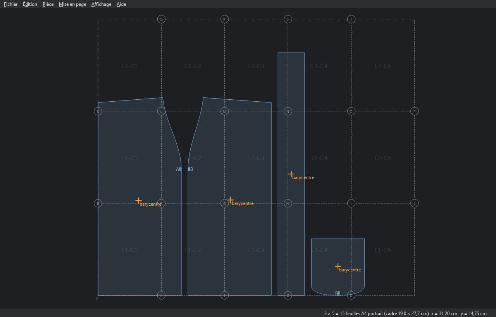

### À propos : version de l'application

**Aide > À propos de CutLayout…** indique la version de CutLayout, l'emplacement du fichier de préférences et les versions des composants (Python, Qt, PySide6, reportlab). Pensez à la citer pour signaler un problème.

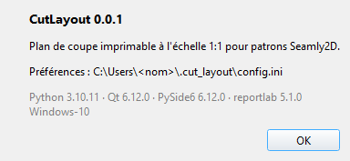

Chaque PDF produit porte aussi la version qui l'a créé, dans ses propriétés : dans le lecteur PDF, **Fichier > Propriétés**, champ « Application » ou « Créateur », par exemple `CutLayout 0.0.1`.

## 15. Ce que CutLayout lit dans un patron Seamly2D

CutLayout recalcule la géométrie lui-même. Il ne connaît donc qu'une partie des outils de Seamly2D. Tout ce qu'il ne connaît pas est **refusé à l'ouverture**, avec un message qui nomme chaque élément : jamais de pièce fausse sans avertissement.

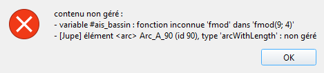

*Patron de démonstration modifié : une fonction et un arc inconnus. Aucune pièce n'est importée.*

### Outils de construction reconnus

| Outil | Type dans le `.sm2d` |
| --- | --- |
| Point de départ (coordonnées) | `single` |
| Point à une distance et un angle d'un autre point | `endLine` |
| Point le long d'une ligne | `alongLine` |
| Point au croisement du x d'un point et du y d'un autre | `intersectXY` |
| Courbe simple (deux points, deux tangentes) | `simpleInteractive` |
| Chemin de courbes (plusieurs points) | `pathInteractive` |
| Ligne entre deux points (tracé seulement) | `line` |

Pièces : contour formé de points, de courbes et de chemins de courbes. Les options **au pli** et **retournement interdit** de la pièce sont lues.

### Formules

- Opérateurs `+ - * / ^` et parenthèses, mesures du `.smis`, variables `#…`.
- Longueurs et angles calculés : `Line_A_B`, `AngleLine_A_B`, `Spl_A_B`, `SplPath_A_B`, `CurrentLength`.
- Fonctions (casse respectée : `acosD` est juste, `acosd` est refusé) :

| Groupe | Fonctions |
| --- | --- |
| Générales | `abs sqrt exp ln log log10 log2 sign rint min max sum avg` |
| Trigonométrie en **radians** | `sin cos tan asin acos atan` |
| Trigonométrie en **degrés** | `sinD cosD tanD asinD acosD atanD` |
| Hyperboliques | `sinh cosh tanh asinh acosh atanh` |
| Conversions, constante | `radTodeg degTorad _pi` |

Les arguments se séparent par `;`, par exemple `min(a; b)`.

Pour qu'un outil manquant soit ajouté, il faut un petit patron qui l'utilise et quelques coordonnées relevées dans Seamly2D pour valider le calcul. La validation du calcul est décrite dans la [note de validation](../NOTE_validation_geometrie.md).

## 16. Raccourcis clavier

| Raccourci | Action |
| --- | --- |
| `Ctrl+O` | Ouvrir un patron |
| `Ctrl+Maj+O` | Ouvrir un plan de coupe |
| `Ctrl+S` / `Ctrl+Maj+S` | Enregistrer le plan de coupe / sous… |
| `Ctrl+E` | Exporter le PDF |
| `F5` | Recharger les préférences |
| `Ctrl+Z` | Annuler |
| `Ctrl+Y`, `Ctrl+Maj+Z` | Rétablir |
| `Ctrl+I` | Propriétés de la pièce sélectionnée |
| `Suppr` | Retirer la pièce sélectionnée du plan |
| `Ctrl+Maj+P` | Mise en page |
| `Ctrl+0` | Tout afficher |

## 17. Limites connues

- **Pas de marge de couture** : les pièces sont imprimées en contour net. Ajoutez la marge de couture en coupant le tissu.
- **Une seule fois chaque pièce** sur le plan : la quantité indiquée dans Seamly2D (par exemple « Dos : 2 ») n'est pas reprise. Coupez la pièce le nombre de fois voulu.
- Le **nom des pièces** n'est imprimé que sur le plan de montage, pas sur les feuilles 1:1. Le **droit-fil** n'est pas imprimé.
- L'échelle 1:1 est garantie **dans le PDF**. L'écran n'est pas à l'échelle.
- Seuls les outils et fonctions de la section 15 sont reconnus.

---

## Pour les contributeurs : régénérer les illustrations

Les images de [`img/`](img/) sont produites par l'application elle-même, à partir du patron de démonstration. Vos préférences ne sont ni lues ni modifiées. Après une modification de l'interface :

```powershell
.venv\Scripts\python tools\tutorial_screenshots.py
```

Le schéma des marges (`img/marges.svg`) est dessiné à la main.
